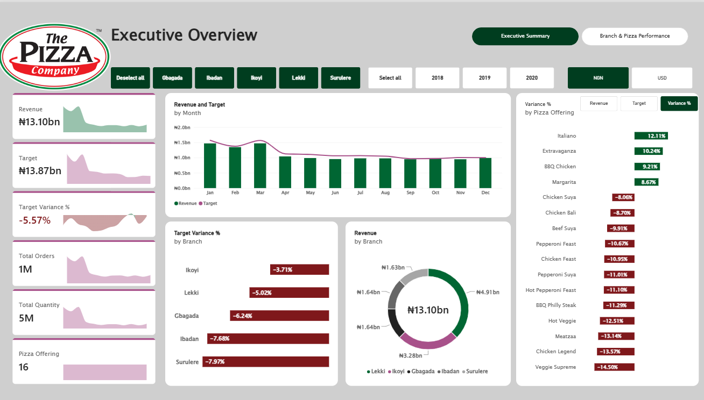
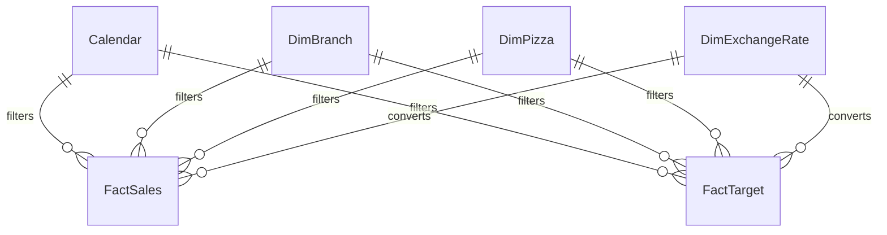

#  Pizza Sales & Target Performance 🍕| Power BI

**An interactive analysis of sales and target performance across branches, pizza offerings, and reporting periods.**

🔗 **[Open the Interactive Power BI Report ↗](https://app.powerbi.com/view?r=eyJrIjoiYmRlOWMwMDUtYTczZi00NWFmLTg2ODMtMzJmNjY1YjViYTg5IiwidCI6IjViMmFkZmYyLTdkMzctNDcyMS05M2FiLTYyNGZmMDYyNmRjMCJ9)** · 📄 [DAX Reference](docs/DAX-Reference.docx) · 💼 [LinkedIn](https://linkedin.com/in/olamidequzeem91)

## Project Overview📌

I built this Power BI report solution to analyse how actual sales compare with business targets and identify the branches and pizza offerings behind the results.

The report combines transaction-level sales and monthly target data in a dimensional model. It provides an executive overview of performance alongside more detailed comparisons by branch, pizza offering, and month.

It also includes an NGN/USD currency toggle, dynamic format strings, and interactive metric selection.

**Key figures from the all-period NGN view:**

| Metric | Result |
|---|---:|
| Revenue | ₦13.10bn |
| Target | ₦13.87bn |
| Target Variance | -5.57% |
| Total Orders | 999,999 |
| Total Quantity | 4,537,146 |
| Branches | 5 |
| Pizza Offerings | 16 |

## Report Preview📊

### 1. Executive Summary



The executive page brings together the main performance indicators, monthly revenue and target trends, branch comparisons, and pizza-offering analysis.

### 2. Branch & Pizza Performance


This page provides a closer look at revenue, targets, and quantity sold across pizza offerings, alongside a branch-level performance matrix.

## Key Findings🔍

The following observations are based on the all-period NGN view of the report.

### Overall Performance

Revenue stands at **₦13.10bn** against a target of **₦13.87bn**, leaving a shortfall of approximately **₦773m (5.57%)**.

### Branch Performance

- **Ikoyi:** Recorded the smallest target variance at approximately -3.71%.
- **Surulere:** Had the largest shortfall at approximately -7.97%.
- **Lekki:** Recorded a variance of approximately -5.02%.
- **Gbagada:** Recorded a variance of approximately -6.24%.
- **Ibadan:** Recorded a variance of approximately -7.68%.

### Pizza Offering Performance

- **Margarita** recorded the highest revenue, approximately ₦2.10bn.
- **Extravaganza** recorded the lowest revenue, approximately ₦521m.

These results provide useful areas for further investigation. For example, the differences between Ikoyi and Surulere can be explored by comparing their monthly sales trends and pizza-offering performance.

Operational information such as product availability, opening hours, promotions, and staffing would provide additional context when investigating the differences.

## What I Implemented🛠️

### Executive Reporting

- KPI cards covering Revenue, Target, Target Variance %, Total Orders, Total Quantity, and Pizza Offering.
- Monthly Revenue-versus-Target trend.
- Branch-level target variance and revenue comparisons.
- Pizza-offering analysis with selectable metrics.

### Interactive Analysis

- Branch and year slicers for filtering report results.
- NGN/USD currency selection.
- Field Parameters for switching between Revenue, Target, and Target Variance %.

### Visual Enhancements

- Conditional formatting based on performance.
- Matrix data bars for comparing branch-level figures.
- Smart Narrative for generating summaries from the current report context.
- Dynamic format strings for currency-aware values and symbols.

## Data Model🧩

The semantic model consists of two fact tables connected to shared dimensions. This structure allows sales and target figures to be analysed using common date, branch, and pizza filters.

### Data Model Diagram



### Fact Tables

| Table | Description |
|---|---|
| **FactSales** | Contains transaction ID, date, time, branch ID, pizza ID, unit price, quantity, discount rate, and calculated sales/discount values in NGN and USD. |
| **FactTarget** | Contains target date, year-month, branch ID, pizza ID, and target values in NGN and USD. |

### Shared and Supporting Tables

| Table | Purpose |
|---|---|
| **Calendar** | Date, year, month, month sort key, and quarter. |
| **DimBranch** | Branch ID, branch name, location coordinates, and manager. |
| **DimPizza** | Pizza ID and pizza offering name. |
| **DimExchangeRate** | Year-month and corresponding USD exchange rate. |
| **Currency** | Disconnected table used for currency selection. |
| **Metric** | Field Parameter used to switch between Revenue, Target, and Variance %. |
| **_Measures** | Dedicated table containing report measures. |

## Data Preparation & Modeling⚙️

I used Power Query to connect to and transform the source data. The preparation process involved merging and appending tables, unpivoting data where appropriate, and creating and standardising key columns.

Particular attention was given to matching branch IDs, pizza IDs, and dates across the sales and target tables so that both fact tables could work with the same dimensions.

The model uses active, one-to-many relationships from the shared dimensions to the fact tables.

Sales are recorded at transaction level, while targets are recorded monthly by branch and pizza offering. This difference in granularity is important when interpreting target comparisons across reporting periods.

## DAX & Modeling Highlights🧮

The model uses calculated columns for row-level currency conversion and explicit DAX measures for aggregating sales and targets based on the selected filters.

### Revenue

```dax
Revenue =
    IF(
        SELECTEDVALUE('Currency'[Currency]) = "NGN",
        SUM(FactSales[Sales NGN]),
        SUM(FactSales[Sales USD])
    )
```

### Target

```dax
Target =
    IF(
        SELECTEDVALUE('Currency'[Currency]) = "NGN",
        SUM(FactTarget[Target NGN]),
        SUM(FactTarget[Target USD])
    )
```

### Metric Conditional Formatting

```dax
Metric CF =
SWITCH(
    TRUE(),
    MAX(Metric[Metric]) = "Revenue", "#005828",
    MAX(Metric[Metric]) = "Target", "#A8518A",
    MAX(Metric[Metric]) = "Variance %" && [Target Variance %] > 0, "#005828",
    MAX(Metric[Metric]) = "Variance %" && [Target Variance %] < 0, "#7F181B",
    "#000000"
)
```

The report also uses dynamic format strings to display the appropriate currency symbol, a Field Parameter for metric selection, and additional measures for conditional formatting.

📄 **[View the DAX Reference](docs/DAX-Reference.docx)** for the calculated columns, Calendar table, measures, dynamic format strings, Field Parameter, and conditional-formatting logic.

## Business Implications💡

The current report highlights a 5.57% gap between revenue and target, with Surulere showing the largest branch-level variance.

A closer review of Surulere's monthly performance and pizza-offering mix could help identify where the shortfall is concentrated. Ikoyi also provides a useful comparison point because it has the smallest variance among the five branches.

The analysis can be extended with operational data such as inventory, product availability, staffing, and promotional activity to investigate possible reasons for the observed differences.

## Repository Contents📁

```text
.
├── assets/
│   ├── executive-summary.png
│   └── branch-pizza-performance.png
│
├── docs/
│   ├── DAX-Reference.docx
│   └── case-study.pdf
│
├── report/
│   └── Pizza-Sales-and-Target-Performance.pbix
│
└── README.md
```

## Access Report & Project Files📥

-  **Interactive Report:**📊 [Open Power BI Report](https://app.powerbi.com/view?r=eyJrIjoiYmRlOWMwMDUtYTczZi00NWFmLTg2ODMtMzJmNjY1YjViYTg5IiwidCI6IjViMmFkZmYyLTdkMzctNDcyMS05M2FiLTYyNGZmMDYyNmRjMCJ9)
-  **Power BI File:**💻 [Download PBIX](report/Pizza-Sales-and-Target-Performance.pbix)
-  **PDF Export:**📄 [View Report PDF](docs/case-study.pdf)
-  **DAX Documentation:**🧮 [View DAX Reference](docs/DAX-Reference.docx)


## 👨‍💻 Author

**Quzeem Olamide**

Data & BI Analyst

🌐 [Portfolio](https://quzeem91.github.io) · 💼 [LinkedIn](https://linkedin.com/in/olamidequzeem91) · 🐙 [GitHub](https://github.com/quzeem91)
