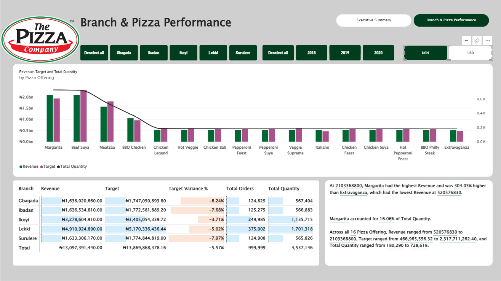
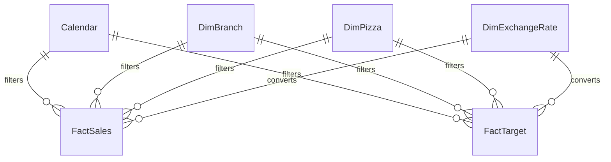

# Pizza Sales & Target Performance | Power BI

**Turning transaction and target data into a decision-ready view of sales performance across branches, products, and pizza offerings.**

**<a href="https://app.powerbi.com/view?r=eyJrIjoiYmRlOWMwMDUtYTczZi00NWFmLTg2ODMtMzJmNjY1YjViYTg5IiwidCI6IjViMmFkZmYyLTdkMzctNDcyMS05M2FiLTYyNGZmMDYyNmRjMCJ9" target="_blank" rel="noopener noreferrer">
  Open the interactive report ↗
</a>** · [Explore the DAX](Power_BI_Instructor_Completed_Report_DAX.md) · [Connect with me](https://linkedin.com/in/olamidequzeem91)

I developed this end-to-end Power BI report solution to address a practical business question: **Are sales meeting target, and where should the business focus its attention?** The report brings together sales and target data in a dimensional model, then makes performance explorable through interactive pages, a currency toggle, and context-aware visuals.

> **At a glance:** ₦13.10bn revenue · ₦13.87bn target · **5.57% below target** · 5 branches · 16 pizza offerings

## Report Preview

### Executive Summary


### Branch & Pizza Performance




## Business Challenge

Sales and targets are difficult to compare when they are spread across different tables and business views. Stakeholders need to see overall performance, spot branch and product variances, and move between NGN and USD without losing context.

I addressed this by creating a two-fact model with shared dimensions and a report that supports both executive monitoring and branch/product investigation.

## Findings from the Current Report View

In the current all-period NGN view, sales are **₦773m below the ₦13.87bn target**, a **5.57% shortfall**.

| Metric | Result |
|---|---:|
| Revenue | ₦13.10bn |
| Target | ₦13.87bn |
| Variance from target | -5.57% |
| Orders | 999,999 |
| Units sold | 4,537,146 |
| Pizza offerings | 16 |

Additional observations:

- **Ikoyi** is closest to its target among the branches, at approximately **-3.71%** variance.
- **Surulere** has the largest shortfall among branches shown, at approximately **-7.97%**.
- **Margarita** has the highest total revenue among the pizza offerings; **Extravaganza** has the lowest.

These are results from the report's current filter context. Changing year, branch, product, or currency changes the displayed results.

## How the Analysis Can Inform Decisions

The report is a starting point for investigation, not proof of what caused performance differences. In the current view, the **5.57% overall shortfall** suggests managers should identify which branches, months, and pizza offerings contribute most to the gap before deciding on an intervention.

The branch comparison gives a practical next step:

1. **Prioritize a review of Surulere**, which has the largest reported branch variance at approximately **-7.97%**.
2. **Use Ikoyi as a comparison point**, since its variance is closest to target at approximately **-3.71%**.
3. **Compare the two branches by month and pizza offering** using the report filters. Look for differences in sales trends, product mix, order volume, and target attainment that may guide follow-up questions.
4. **Validate with operational context**—such as availability, opening hours, local promotions, or staffing—before attributing the gap to any one factor or recommending a change.

The current model supports comparisons of revenue, targets, orders, quantity, branch, product, and time. It does not include costs, profit margins, inventory, customer satisfaction, or causal evidence. Those data sources would be needed to evaluate profitability, stock-outs, customer experience, or whether a particular operational change improves results.

## What I Built

- **Executive summary:** A high-level view of revenue, target, target variance, order volume, and monthly trends.
- **Branch and product analysis:** Comparisons that help identify where target gaps and revenue concentration occur.
- **Interactive metric selection:** A Field Parameter lets users switch the product visual between Revenue, Target, and Target Variance %.
- **Dual-currency analysis:** Users can toggle between NGN and USD; currency-aware measures and dynamic format strings update values and symbols together.
- **Contextual visual design:** Conditional formatting, matrix data bars, and Smart Narrative add cues and summaries to the analysis.

The goal was not just to display totals, but to make it easy to move from **“Are we on target?”** to **“Which branches or products are contributing to the gap?”**

## Report Pages

### 1. Executive Summary

- KPI cards for Revenue, Target, Target Variance %, Total Orders, Total Quantity, and Pizza Offering.
- Monthly Revenue-versus-Target trend.
- Target variance by branch and revenue by branch.
- Pizza-offering comparison with a **Field Parameter** that lets users switch the visual between Revenue, Target, and Variance %.

### 2. Branch & Pizza Performance

- Revenue, Target, and Total Quantity comparison by pizza offering.
- Branch-level matrix with Revenue, Target, Target Variance %, Total Orders, and Total Quantity.
- Conditional formatting, data bars, and a Smart Narrative to add context to the results.

## Interactive Features

- **NGN/USD currency toggle:** Switch the report between Nigerian naira and US dollars. Currency-aware Revenue and Target measures select the matching values.
- **Dynamic format strings:** Currency-aware measures update their display format and `₦` or `$` symbol with the currency selection, avoiding duplicate measures or visuals for each currency.
- **Field Parameter:** Switch the product comparison visual between Revenue, Target, and Target Variance %. This puts multiple analytical views in one visual and lets readers choose the metric they want to explore.
- **Cross-filtering and slicers:** Branch, year, and currency selections interact with the report visuals to support focused comparisons.
- **Conditional formatting and data bars:** Highlight performance differences and make values easier to compare in the matrix.
- **Smart Narrative:** Provide a text summary of selected report data.

## Data Model

The semantic model contains two fact tables connected to shared dimensions. This lets users analyze sales and targets using common date, branch, and pizza filters.



### Fact tables

- **FactSales:** Transaction ID, date, time, branch ID, pizza ID, unit price, quantity, discount rate, and calculated sales/discount values in NGN and USD.
- **FactTarget:** Target date, year-month, branch ID, pizza ID, and target values in NGN and USD.

### Shared and supporting tables

- **Calendar:** Date, year, month, month sort key, and quarter.
- **DimBranch:** Branch ID, branch name, location coordinates, and manager.
- **DimPizza:** Pizza ID and pizza offering name.
- **DimExchangeRate:** Year-month and USD exchange rate.
- **Currency:** Disconnected selector used by currency-aware measures.
- **Metric:** Field parameter used to switch a visual between Revenue, Target, and Variance %.
- **_Measures:** Dedicated table containing report measures.

## Data Preparation and Modeling

Power Query was used to connect to and transform the source data, merge and append tables, and unpivot data where appropriate. I also created and standardized the key columns needed to connect both fact tables to the same dimensions—for example, matching branch IDs, pizza IDs, and dates across sales and targets. These transformations prepared the tables for the shared-dimension model and enabled consistent filtering across both facts.

The report model uses active, one-to-many relationships from the shared dimensions to both fact tables. Sales are recorded at transaction grain, while targets are monthly by branch and pizza offering. Target comparisons should therefore be interpreted at a compatible time grain.

## DAX and Modeling Highlights

The model uses calculated columns for row-level currency conversion and explicit measures for filter-responsive aggregations. The [complete DAX reference](Power_BI_Instructor_Completed_Report_DAX.md) documents the calculated columns, Calendar table, measures, dynamic format strings, field parameter, and conditional-formatting measures.

Examples of the model's measures:

```DAX
Revenue =
    IF(
        SELECTEDVALUE('Currency'[Currency]) = "NGN",
        SUM(FactSales[Sales NGN]),
        SUM(FactSales[Sales USD])
    )
```

```DAX
Target =
    IF(
        SELECTEDVALUE('Currency'[Currency]) = "NGN",
        SUM(FactTarget[Target NGN]),
        SUM(FactTarget[Target USD])
    )
```

```DAX
Metric CF = 
SWITCH(
    TRUE(),
    MAX(Metric[Metric]) = "Revenue", "#005828",
    MAX(Metric[Metric]) = "Target", "#A8518A",
    MAX(Metric[Metric]) = "Variance %" && [Target Variance %] > 0, "#005828",
    MAX(Metric[Metric]) = "Variance %" && [Target Variance %] < 0, "#7F181B",
    "#000000"
)
```

The report also uses dynamic format strings for currency display, a Metric field parameter, and DAX measures that return color values for conditional formatting.


## Access Report & Project Files

- **Interactive report:** [View the published Power BI report](https://app.powerbi.com/view?r=eyJrIjoiYmRlOWMwMDUtYTczZi00NWFmLTg2ODMtMzJmNjY1YjViYTg5IiwidCI6IjViMmFkZmYyLTdkMzctNDcyMS05M2FiLTYyNGZmMDYyNmRjMCJ9)
- **PBIX file:** [Download the Power BI file](ADD_PBIX_LINK_OR_REPOSITORY_PATH)
- **PDF export:** [View the report PDF](docs/case-study.pdf)
- **DAX reference:** [View the DAX documentation](Power_BI_Instructor_Completed_Report_DAX.md)


## Author

**Quzeem Olamide** 
— [Portfolio](https://quzeem91.github.io) · [LinkedIn](https://linkedin.com/in/olamidequzeem91)
